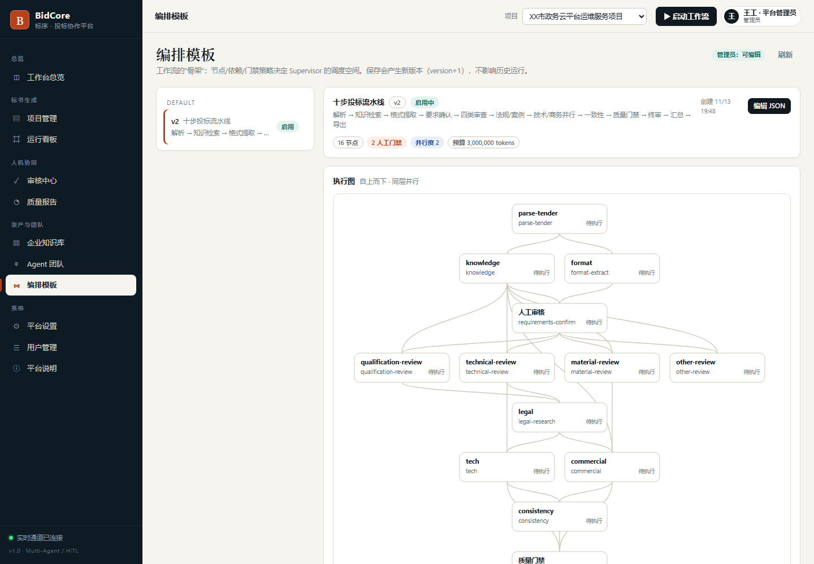
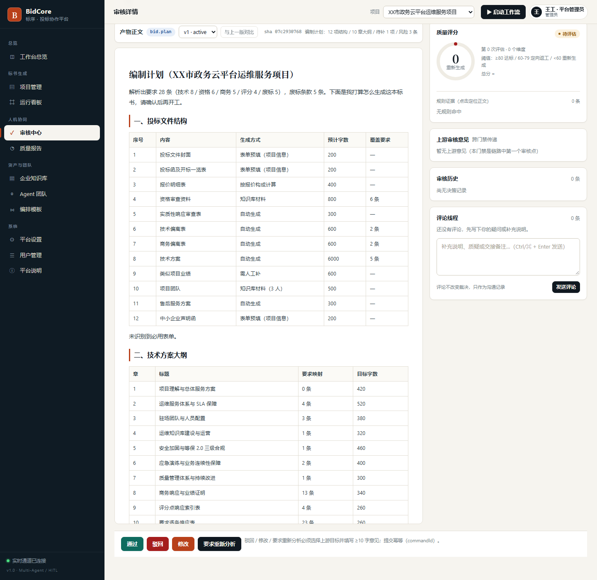
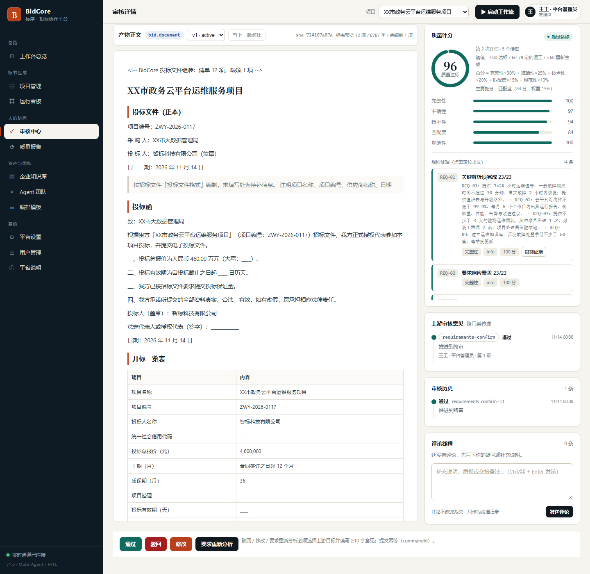
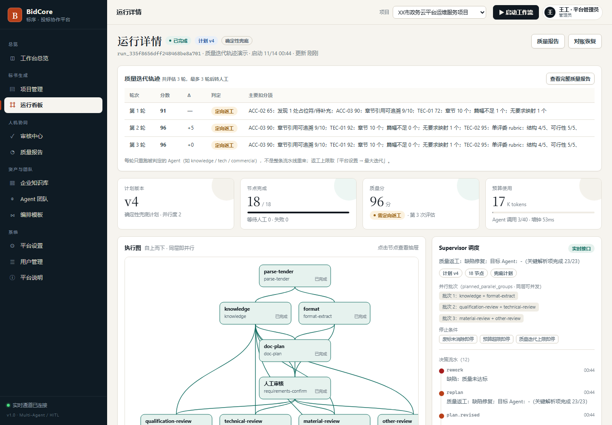
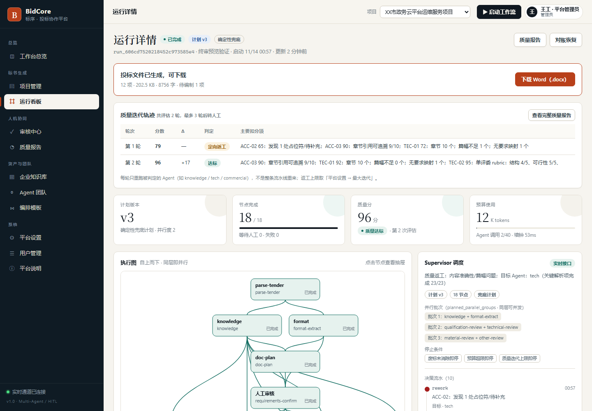
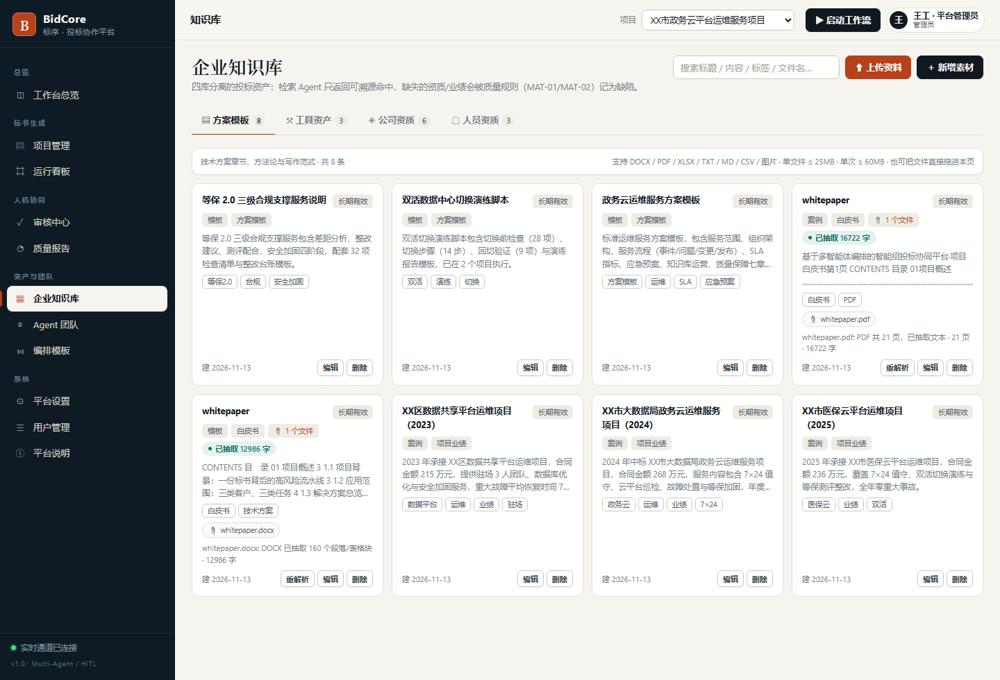

# BidCore · 标序

<p align="center">
  <a href="https://github.com/Gamesome666/BidCore/actions/workflows/ci.yml"></a>
  
  
  
  
  
  
</p>

> 可人工干预的 Multi-Agent 投标文件编排平台：上传招标文件 → 解析要求 → 出编制计划 → 人工确认 → 分类审查 → 写技术/商务标 → 一致性检查 → 质量闭环 → 预览整本标书 → 终审 → 导出 Word。
>
> 零 npm 依赖 · `node:http` + `node:sqlite` · 零构建 SPA（原生 ES Module）· 单文件数据库。
> 不配置模型时自动使用**确定性 Mock 写作器**，断网也能跑通全链路演示；配置真实模型后逐章生成正文。

```bash
git clone https://github.com/Gamesome666/BidCore.git && cd BidCore
node server/index.mjs      # → http://127.0.0.1:5192 ，admin / admin123 登录
```

**目录**：[亮点](#亮点) · [截图](#截图) · [快速开始](#快速开始) · [模型接入](#模型接入) ·
[工作流](#工作流18-节点十步) · [标书怎么组装](#投标文件怎么组装) · [质量闭环](#质量闭环) ·
[解析能力](#解析能力) · [配置项](#配置项) · [API](#api-摘要) · [测试](#测试与验收) ·
[已知限制](#已知限制) · [路线图](#路线图) · [结构](#项目结构) · [安全](#安全说明) · [许可](#许可证)

---

## 亮点

| 能力 | 说明 |
|---|---|
| **18 节点十步流水线** | 解析 → 知识检索 → 格式提取 → **编制计划** → **人工确认** → 四类审查（资格/技术/材料/其他）→ 法规案例 → 技术/商务并行 → 一致性 → 质量门禁 → **标书预览** → **终审** → 汇总 → 导出 |
| **两道人工闸门** | 第一关确认「总控 Agent 打算怎么生成这本标书」（结构/大纲/取材/缺口/风险）；第二关看**整本标书正文**再签字。级别可配 1/2/3 级会签 |
| **按招标目录组标** | 投标文件顺序取招标「第七章 投标文件格式」；技术方案子项优先取「3.1 技术文件」清单，没有则从第七章备注推导，最后才用内置模板 |
| **质量闭环** | 5 维 18 条确定性规则 → 不达标自动定向返工（最多 3 轮）→ 每轮分数、重跑 Agent 全程可见 → 仍不达标才转人工 |
| **内容看得见** | 终审页直接渲染整本标书正文；运行页顶部一键下载 `.docx`；质量迭代轨迹与扣分项逐轮列出 |
| **自适应解析** | 章号随便叫（第七章/第六章/无章号）；「评标委员会/评标原则」等程序条款自动排除；扫描件 PDF 明确报错；`.doc/.wps` 调用本机 Word/WPS 转 docx |
| **零依赖** | 无 npm 包、无构建步骤；自研 docx/pdf/xlsx 解析、Markdown→Word 生成、SQLite 租约调度 |

## 截图

| 十步流水线 | 第一关：编制计划 |
|---|---|
|  |  |

| 第二关：整本标书正文 | 质量迭代轨迹 |
|---|---|
|  |  |

| 跑完直接下载 | 企业知识库上传 |
|---|---|
|  |  |

## 快速开始

要求 **Node ≥ 22.13（推荐 24.x）**，无需 `npm install`。首次启动自动建表 + 写入演示数据。

```bash
node server/index.mjs            # 等价 npm start
# → http://127.0.0.1:5192
```

| 项 | 值 |
|---|---|
| Web | http://127.0.0.1:5192 |
| 健康检查 | `/api/health` |
| 数据库 | `var/bidcore.db`（WAL，附件在 `var/files/`） |
| 换端口 | `PORT=5197 node server/index.mjs` |
| 重置数据 | `node server/reset.mjs`（`npm run reset`） |
| 冒烟测试 | `node server/smoke.mjs`（`npm run smoke`） |
| 演示数据 | `node tools/demo.mjs` |

### 导入知识库演示数据包

仓库自带 `tools/knowledge-pack.json`（27 篇：资质、业绩、财务、授权函等样例），服务启动后执行一次即可导入，让「资质命中 MAT-01」不再是缺口：

```bash
node tools/import-knowledge.mjs          # 默认 http://127.0.0.1:5192，admin/admin123
node tools/import-knowledge.mjs --base http://127.0.0.1:5197 --user admin --pass xxx
```

导入脚本只新增库中不存在的同名文档，重复执行安全；数据包内不含任何密钥。

> 不导入也能跑通流程，但空知识库下 `MAT-01` 会判为阻塞（命中不足），质量分封顶 79 并转人工补资料 —— 这是设计预期，不是故障。

### 演示账号

| 账号 | 密码 | 角色 |
|---|---|---|
| `admin` | `admin123` | 平台管理员（设置 / 用户 / 任意审核） |
| `owner` | `owner123` | 项目负责人（终审第 1 级） |
| `tech` / `biz` | `tech123` / `biz123` | 技术负责人 / 商务负责人 |
| `reviewer` | `reviewer123` | 质量审核员 |

> 仅用于本地演示，部署到公网前请改密码、设 `BIDCORE_SECRET`，并限制访问来源。

## 模型接入

两种方式，任选其一：

**① 页面配置**：`平台设置 → 模型接入`，填 `Base URL` / `API Key` / 模型名，点「保存模型配置」。
保存后会自动探活，模型名不被服务端接受会**当场报错**（不会静默回退）。

**② 环境变量**（推荐，避免界面误改）：

```bash
LLM_MODE=openai \
LLM_BASE_URL=https://api.deepseek.com/v1 \
LLM_API_KEY=sk-xxxx \
LLM_MODEL=deepseek-chat \
node server/index.mjs
```

要点：

- `Base URL` 需兼容 OpenAI `/chat/completions`
- **模型名必须被服务端接受**：例如 DeepSeek 官方是 `deepseek-chat`；某些网关只认 `deepseek-flash` / `deepseek-v4-pro`
- 不配模型（`LLM_MODE=mock`）时，正文由 Mock 写作器生成：**每章 200–350 字**，只适合验证流程，不适合当标书用
- 模型调用失败时，运行页顶部会显示「模型调用失败，正文已回退模板」并给出原始报错
- 模型可按 Agent 档位分流：`LLM_MODEL`（strong：技术/策略/编制计划）、`LLM_JUDGE_MODEL`（fast：检索/复核/文档）

## 工作流：18 节点十步

```text
parse-tender ─┬─ knowledge ─┬─ doc-plan ── 人工确认 ─┬─ qualification-review ─┐
              └─ format ────┘                       ├─ technical-review ────┤
                                                     ├─ material-review ────┤
                                                     └─ other-review ───────┘
                                                                   │
                                                              legal-research
                                                                   │
                                                        tech ───────── commercial
                                                           │              │
                                                       consistency ───────┘
                                                             │
                                                        quality-gate ← 不达标则定向返工（最多 3 轮）
                                                             │
                                                          preview（组装整本标书正文）
                                                             │
                                                        终审（看全文）
                                                             │
                                                        summary → export(.docx)
```

| # | 节点 | 产物 |
|---|---|---|
| 1 | `parse-tender` | `tender.analysis`：要求清单、评分点、废标条款、技术文件子项 |
| 2 | `knowledge` | `knowledge.pack`：资质/业绩/人员命中与缺口 |
| 3 | `format-extract` | `tender.format`：投标文件组成 N 项、必用表单 |
| 4 | `doc-plan` | `bid.plan`：结构 / 技术大纲 / 取材来源 / 待补材料 / 风险 |
| 5 | `requirements-confirm` | 人工闸门（1 级） |
| 6–9 | 四类审查 | `review.qualification / technical / material / other` |
| 10 | `legal-research` | `legal.pack`：法规标准引用与案例 |
| 11–12 | `tech` / `commercial` | `tech.outline` `tech.content` / `commercial.pack` |
| 13 | `consistency` | `consistency.report`：名称/编号/金额/工期口径冲突 |
| 14 | `quality-gate` | `quality:quality-gate`：5 维评分 + 返工建议 |
| 15 | `preview` | `bid.document`：整本标书 Markdown（终审看这个） |
| 16 | `final-approval` | 人工闸门（可配 1/2/3 级会签） |
| 17 | `summary` | `summary.pack`：一页编制说明 |
| 18 | `export` | `doc.docx`：Word 文件，落盘 `var/files/` |

调度是**确定性**的：默认固定使用内置流程，不让模型改流程；需要实验时可在「平台设置 → 编排与调度」打开「模型自定义编排」，缺关键节点会自动回退。

## 投标文件怎么组装

整体顺序以招标文件「第七章 投标文件格式」为准（解析不到时用通用 12 项兜底）：

```text
1 封面 · 2 投标函及开标一览表 · 3 分项报价表 · 4 资格审查资料
5 实质性响应审查表 · 6 技术偏离表 · 7 商务偏离表 · 8 技术方案
9 类似项目业绩 · 10 项目团队 · 11 售后服务方案 · 12 中小企业声明函
+ 附录C 资格证据与缺口 · 附录D 格式核对
```

**技术方案目录的优先级**（从高到低）：

1. 招标「3.1 投标文件的组成 → 技术文件」列出的子项（例：总体架构、数据治理方案、安全与等保方案、培训方案…）
2. 第七章「技术方案」那一项的备注（例：“含总体架构、服务拆分清单、数据中台方案…”）
3. 内置 6 大章 / 23 节模板（仅当前两者都没有）

组装的几条硬规则：

- 表单类（封面/投标函/开标一览表/声明函）用项目与知识库数据预填，签章位留 `____`
- 没有材料的章节写「待编制」，**不编造证书号、金额、人员**
- 资格缺口进附录C，如实标注“满足 / 部分满足 / 缺口”
- 售后服务独立成章，不复制技术方案正文
- 导出前清洗模型偶发的「具体包括：1) 招标原文」整段

## 质量闭环

五维加权：**要求覆盖 30 / 准确性 25 / 技术性 20 / 匹配度 15 / 规范性 10**。

| 维度 | 规则 |
|---|---|
| 要求覆盖 | `REQ-01` 解析完成度 · `REQ-02` 要求→章节覆盖 · `REQ-03` 量化指标可核验 |
| 准确性 | `ACC-01` 事实一致性 · `ACC-02` 占位符扫描 · `ACC-03` 引用可追溯 |
| 技术性 | `TEC-01` 结构完整 · `TEC-02` 评委 rubric · `TEC-03` 重复度 · `TEC-04` **空话率** · `TEC-05` **招标原文复制率** · `TEC-06` **章节深度** |
| 匹配度 | `MAT-01` 资质/业绩命中 · `MAT-02` 证书有效期 · `MAT-03` **知识库引用占比** |
| 规范性 | `DOC-01` 编号层级 · `DOC-02` 导出必填 · `DOC-03` 篇幅达标 |

返工逻辑：

```text
quality-gate 打分
  ├─ ≥ 80 → 通过
  ├─ 60–79 → 定向返工：只重跑扣分对应的 Agent（knowledge / tech / commercial），再打分
  └─ 3 轮仍 < 80 → 转人工（质量门禁闸门，列出每轮分数与本轮重跑的 Agent）
```

`TEC-04/05/06`、`MAT-03` 是提示级规则，不参与“阻塞即封顶”，避免 mock 稿被一刀切判死。

## 解析能力

| 输入 | 支持 |
|---|---|
| 招标文件 | `.docx` `.doc` `.wps` `.pdf` `.md` `.txt`（≤25MB） |
| 企业知识库 | `.docx` `.pdf` `.xlsx` `.csv` `.txt` `.md` 与图片（png/jpg/webp，仅存原件不 OCR） |
| 章节定位 | 按标题语义找「投标文件格式 / 组成 / 编制」「资格审查 / 资格要求」；第几章、有无章号都行 |
| 条款清洗 | 「评标委员会 / 评标原则 / 评标程序 / 澄清」等程序条款不进要求清单与响应表 |
| 扫描件 PDF | 无文本层时返回 `422 PDF_NO_TEXT`，提示走 OCR 后「粘贴正文」；页面内置粘贴入口 |
| 老格式 Office | `.doc/.wps` 调本机 Word/WPS（COM）转 docx；无 Office 环境时明确提示另存为 docx |

## 配置项

设置写入 `settings` 表，页面在「平台设置」：

| 键 | 关键字段 | 说明 |
|---|---|---|
| `llm` | `mode` `base_url` `api_key` `model` `timeout_ms` | `mode=mock` 时正文走模板；`openai` 时保存会校验 key/base_url |
| `quality` | `weights` `passScore` `reviseScore` `maxIterations` `thresholds` | 五维权重合计必须 100；返工上限默认 3 |
| `workflow` | `parallelism` `leaseSeconds` `scanIntervalMs` `enabled` `llm_plan` | `llm_plan` 默认关闭（固定内置流程）；长耗时节点靠心跳续租 |
| `review` | `approvalLevels` `remindRatio` `allowAutoPass` | `approvalLevels` 控制终审会签级数（1/2/3） |

## API 摘要

| 方法 | 路径 | 说明 |
|---|---|---|
| POST | `/api/auth/login` | 登录，返回 Bearer token |
| GET/POST | `/api/projects` | 项目列表 / 新建 |
| POST | `/api/projects/:id/tender/upload` | 上传招标文件（multipart） |
| POST | `/api/projects/:id/tender/text` | 粘贴招标正文（扫描件兜底） |
| POST | `/api/tender/parse` | 只解析不落库（新建项目时预填） |
| POST | `/api/runs` | 启动工作流 |
| GET | `/api/runs/:id` | 运行快照（节点状态/计划/待审） |
| GET | `/api/runs/:id/artifacts/:kind` | 产物明细（`tender.analysis`、`bid.plan`、`tech.content`、`doc.docx`…） |
| POST | `/api/reviews/:id/decisions` | 审核裁决（approve / reject / modify / reanalyze） |
| GET | `/api/reviews/:id` | 审核包：目的、核对清单、迭代记录、动作含义 |
| PUT | `/api/settings` | 平台设置（llm / quality / workflow / review） |
| POST | `/api/llm/probe` | 模型连通性探活 |
| POST | `/api/knowledge/upload` | 知识库多文件上传 |

完整列表见页面「平台说明」或 `server/routes/`。

## 测试与验收

```bash
node server/smoke.mjs
```

基线：**68 通过 / 0 失败 / 1 跳过**（跳过项为 SLA 超时升级，需真实等待 4 小时，改库可手工验证）。

覆盖范围包括：登录与权限、项目 CRUD 与级联删除、招标上传/解析/粘贴正文、知识库上传与解析、工作流 18 节点跑通、两道闸门与多级会签、审核裁决幂等与乐观锁、Self-Loop 返工、质量规则与报告、产物版本、导出下载。

多标书回归（本地脚本，仓库外）：三份结构不同的招标文件（第六章格式 / 无章号 / 无格式章节）跑同一流水线，检查要求数、程序条款残留为 0、大纲来源、标书结构项、原文复制率与章节深度。

## 已知限制

- **Mock 模式不是标书**：每章 200–350 字，只用于验证流程；要真实内容必须配模型
- **扫描件 PDF 无 OCR**：只做检测与提示，需外部 OCR 后粘贴正文
- **材料必须人给**：财务报告、纳税社保、信用截图、授权函等无法生成，只能标「待编制」
- **资质匹配靠知识库**：`MAT-01` 低分通常是缺证书/业绩，不是文案问题
- **单实例设计**：SQLite + 进程内调度；多实例需换数据库与队列
- **模型 Key 明文存库**：本地演示可接受，公网部署请改用环境变量并限制访问
- **图片类知识库不做 OCR**：保留原件，靠人工补摘要

## 路线图

- [ ] 业绩 / 团队章节增加叙述段（现在只有表）
- [ ] 接入本机 OCR（Windows OCR 或 Tesseract 可选），支持扫描件直读
- [ ] 报价明细可编辑（前端表单回写）
- [ ] 多行业模板（当前技术主题偏 IT/信息化）
- [ ] 多租户与对象存储
- [ ] 导出 PDF 版式

## 项目结构

```text
server/
  index.mjs            HTTP 入口、静态资源、启动自检
  seed.mjs             种子数据、Agent 目录、18 节点内置流程、设置迁移
  domain/
    engine.mjs         调度引擎：租约、心跳、并行、返工、失效传播
    planner.mjs        流程校验 + 内置/模型计划
    agents.mjs         各 Agent 处理器（招标分析/知识/格式/编制计划/技术/商务/审查/法规/一致性/汇总/导出）
    bid.mjs            招标解析、大纲、正文写作、商务标
    bidAssembly.mjs    按招标格式组装整本标书
    qualification.mjs  资格证据链与附录C
    quality.mjs        18 条规则 + 五维聚合
    review.mjs         审核包、多级会签、SLA
    docx.mjs           Markdown → Word（标题/加粗/表格）
    llm.mjs            模型调用、Mock 写作器、档位路由
    tenderSections.mjs 章节语义定位与条款解析
  routes/              各 API 路由
  lib/                 multipart、zip、docparse（docx/pdf/xlsx）
web/                   原生 ES Module SPA（无构建）
docs/shots/            README 截图
var/                   运行时数据库与附件（不入库）
tools/                 demo / shot / probe
```

## 安全说明

- 演示账号密码公开，**不要直接暴露到公网**
- `BIDCORE_SECRET` 未设置时使用内置演示值，对外前务必改为随机长串
- API Key 存在 SQLite `settings` 表；生产环境建议只走环境变量
- 详见 [SECURITY.md](SECURITY.md)

## 贡献

欢迎 Issue / PR。提交前请保证 `node server/smoke.mjs` 仍为 **68 通过 / 0 失败 / 1 跳过** 或更好；代码风格与约定见 [CONTRIBUTING.md](CONTRIBUTING.md)。

## 许可证

[MIT](LICENSE) © 2026 YG
