# BidCore · 标序

<p align="center">
  <a href="https://github.com/Gamesome666/BidCore/actions/workflows/ci.yml"></a>
  
  
  
  
  
  
</p>

> 可人工干预的 Multi-Agent 投标标书平台。信息架构对标 **yibiao（[OpenBidKit-Yibiao-Web](https://github.com/jdcome/OpenBidKit-Yibiao-Web)）**，
> 在此之上补上它没有的三层能力：**确定性工作流引擎 + Self-Loop 质量闭环 + HITL 审核中心**。
>
> 零 npm 依赖 · Node 24 `node:http` + `node:sqlite` · 零构建 SPA（原生 ES Module）· 单文件数据库。
> 断网可跑：不配置模型时自动使用**确定性 Mock 写作器**，全链路演示不依赖网络。

```bash
git clone https://github.com/Gamesome666/BidCore.git && cd BidCore
node server/index.mjs          # → http://127.0.0.1:5192 ，用 admin / admin123 登录
```

**章节**：1 快速开始 · 2 界面预览 · 3 问题与方案 · 4 能力地图 · 5 架构 · 6 数据模型 ·
7 API · 8 HITL 行为矩阵 · 9 多级审核 · 10 调度规则 · 11 Self-Loop · 12 模型接入 ·
13 目录结构 · 14 演示脚本 · 15 验收 · 16 与参考实现的关系 · 17 已知问题 ·
[贡献](#贡献) · [许可证](#许可证)

---

## 1. 30 秒启动

```bash
node server/index.mjs
# → http://127.0.0.1:5192
```

要求 Node ≥ 22.13（推荐 24.x），**无需 `npm install`**。首次启动自动建表 + 种子数据，第二次启动复用 `var/bidcore.db`。

| 项 | 值 |
|---|---|
| Web | http://127.0.0.1:5192 |
| 健康检查 | http://127.0.0.1:5192/api/health |
| 数据库 | `bidcore/var/bidcore.db`（WAL，含 `var/files/*.docx`） |
| 端口 | `PORT=5192`（可用 `PORT=5197 node server/index.mjs` 换端口） |
| 重置演示数据 | `node server/reset.mjs`（等价 `npm run reset`） |
| 冒烟 | `node server/smoke.mjs` |
| 演示数据 | `node tools/demo.mjs` |
| 截图 | `node tools/shot.mjs "<url>" docs/shots/x.png --token=<token> --project=1` |

### 演示账号

| 账号 | 密码 | 角色 | 说明 |
|---|---|---|---|
| `admin` | `admin123` | admin | 平台管理员：用户/设置/质量配置，可处理任意审核 |
| `owner` | `owner123` | user | 项目负责人：两个种子项目的 owner，审核第 1 级 |
| `tech` | `tech123` | user | 技术负责人 |
| `biz` | `biz123` | user | 商务负责人：三级审核第 2 级指派人 |
| `reviewer` | `reviewer123` | user | 质量审核员 |

> 权限模型：`admin` 全量；普通用户只能访问 `owner_id = 自己` 的项目（详情/工作台/运行/审核包）。
> 非 admin 访问他人项目返回 `403 FORBIDDEN`，非 admin 调 `/api/users` 返回 `403 ADMIN_ONLY`。

---

## 2. 界面预览

| 登录（未认证） | 工作台总览 |
|---|---|
| 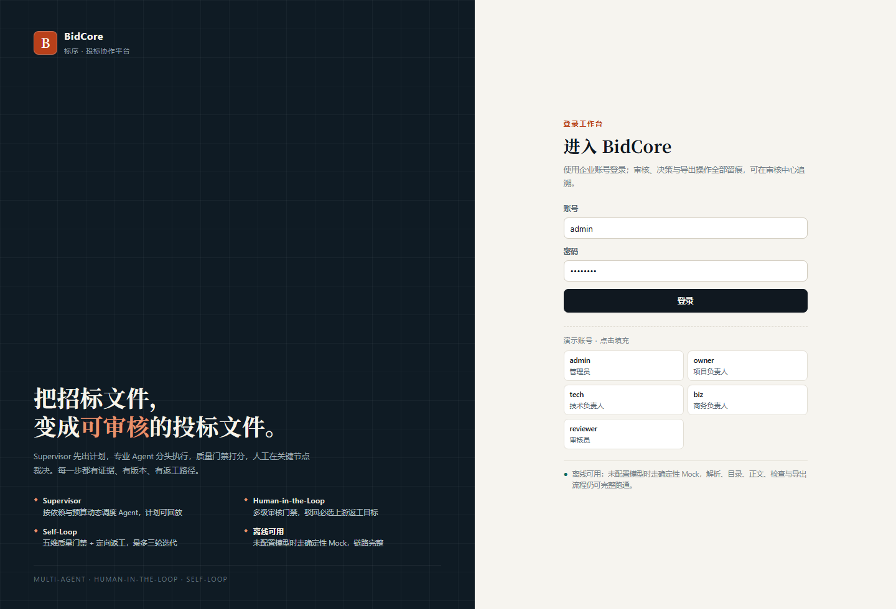 | 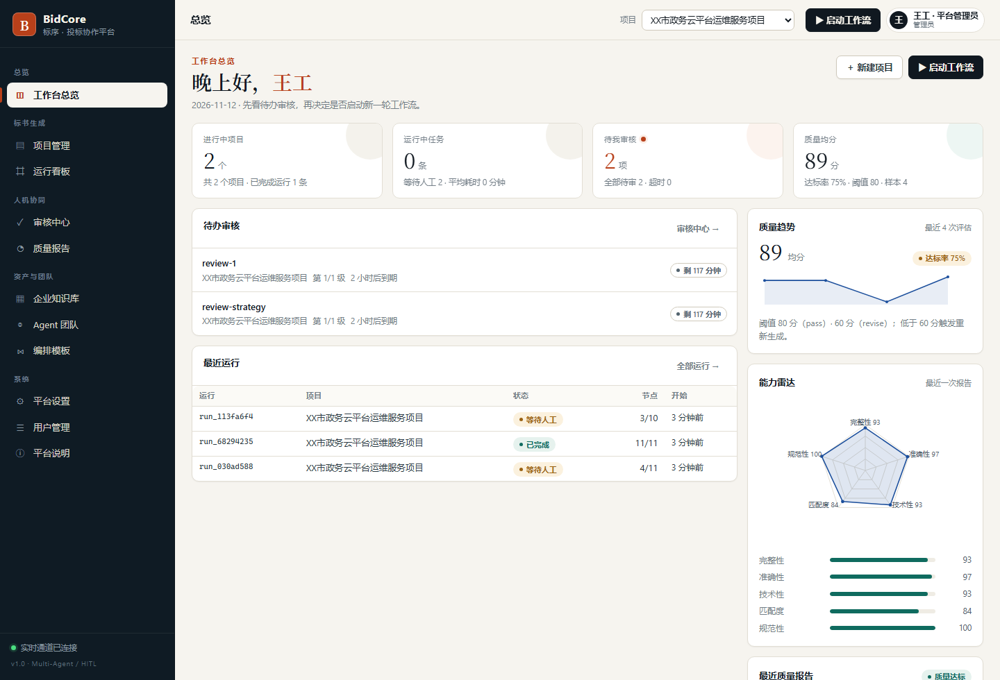 |

| 项目管理 | 项目工作台 · 技术方案 |
|---|---|
| 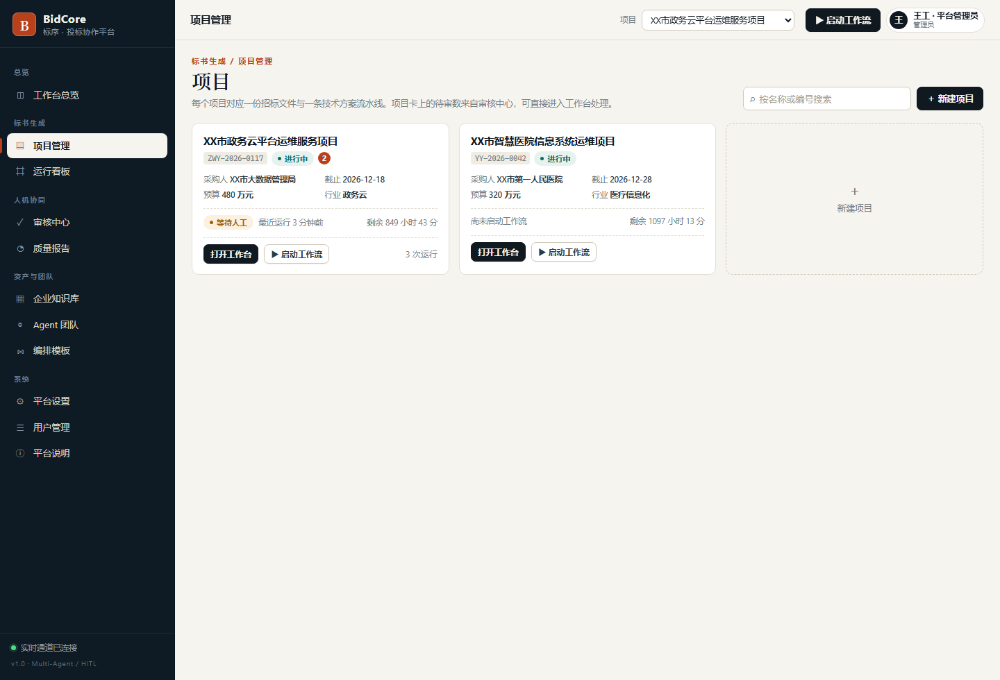 | 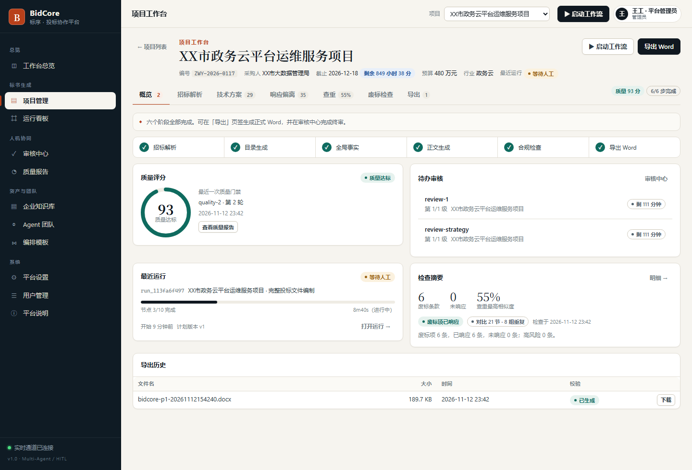 |

| 运行详情（DAG + Supervisor） | 审核中心 |
|---|---|
| 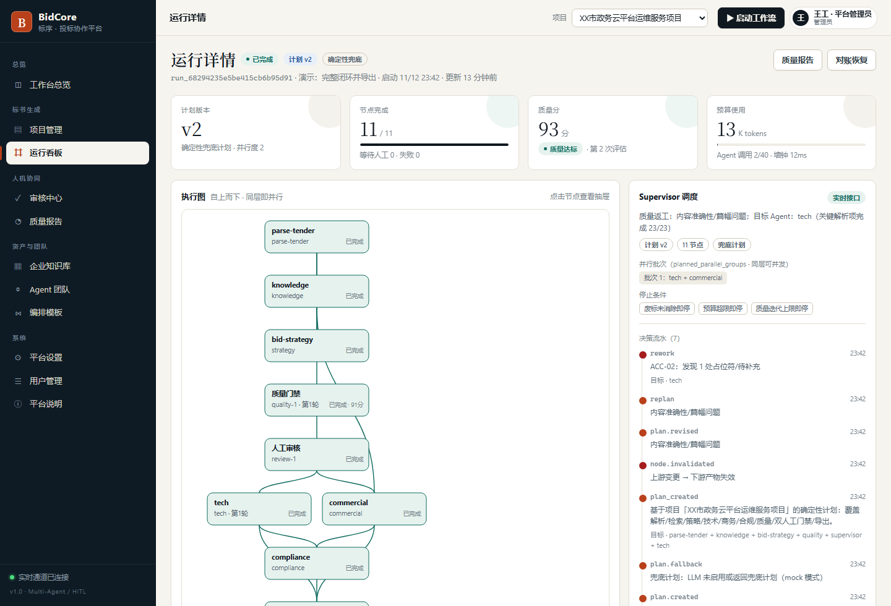 | 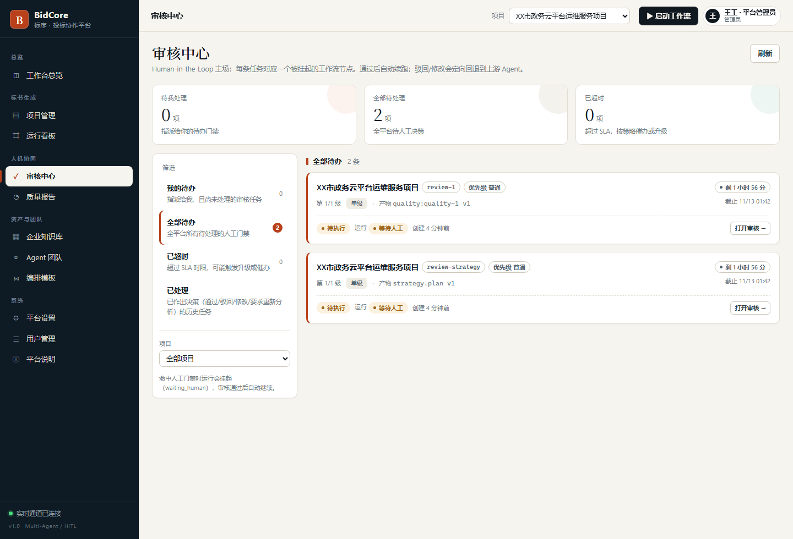 |

| 审核详情（四动作 + 质量 + 版本） | 质量报告 |
|---|---|
| 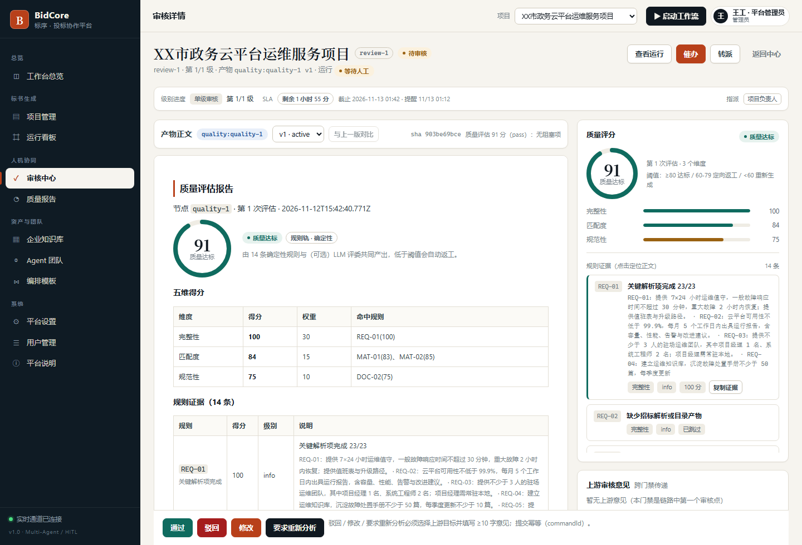 | 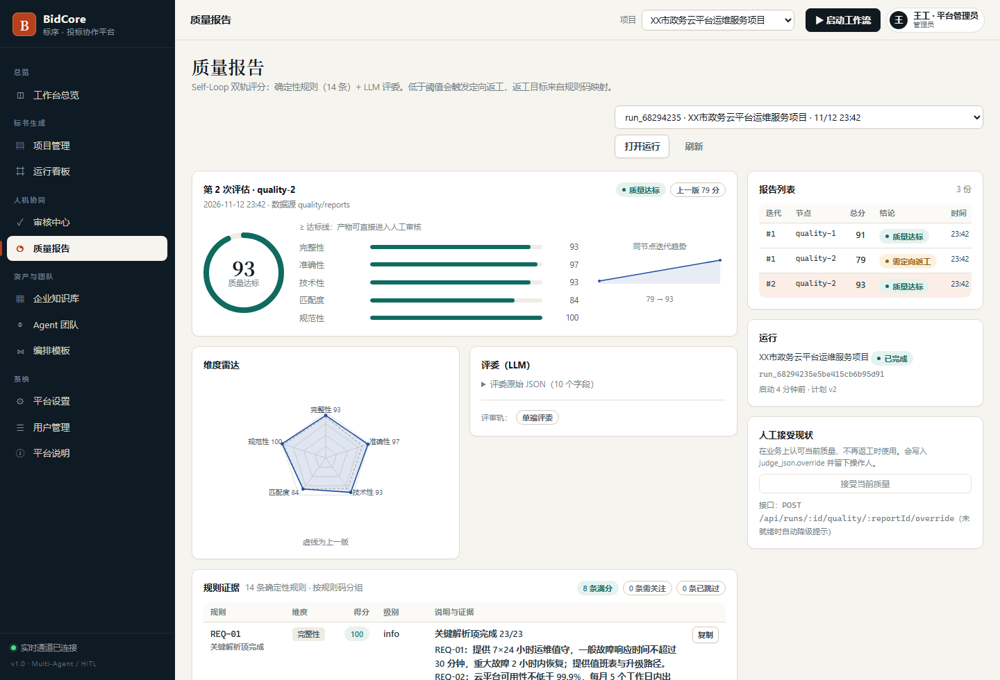 |

| 企业知识库 | Agent 团队 |
|---|---|
| 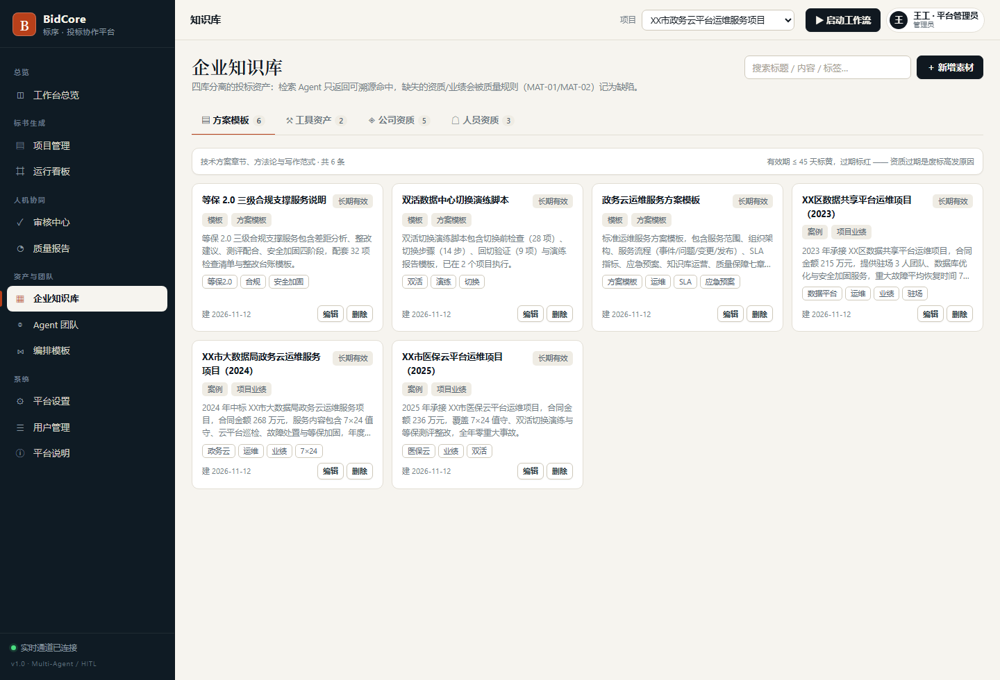 | 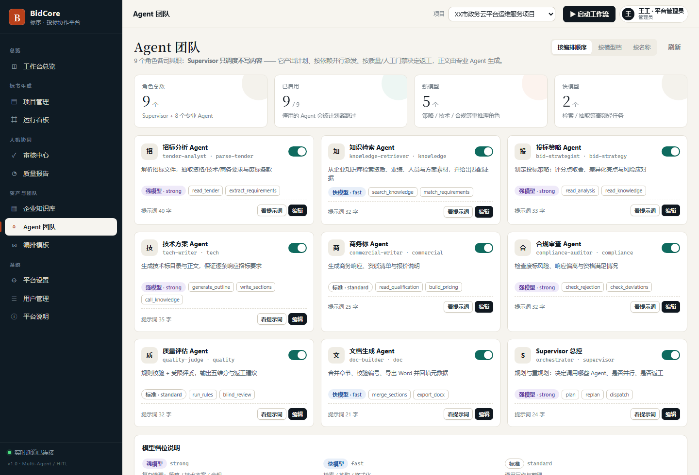 |

| 编排模板 | 平台设置 |
|---|---|
| 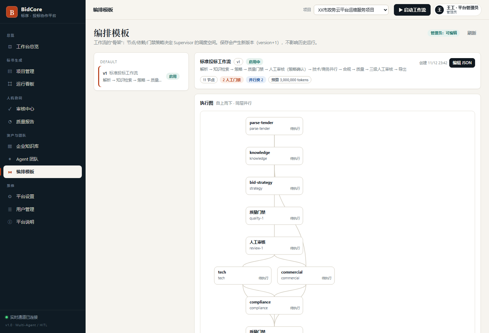 | 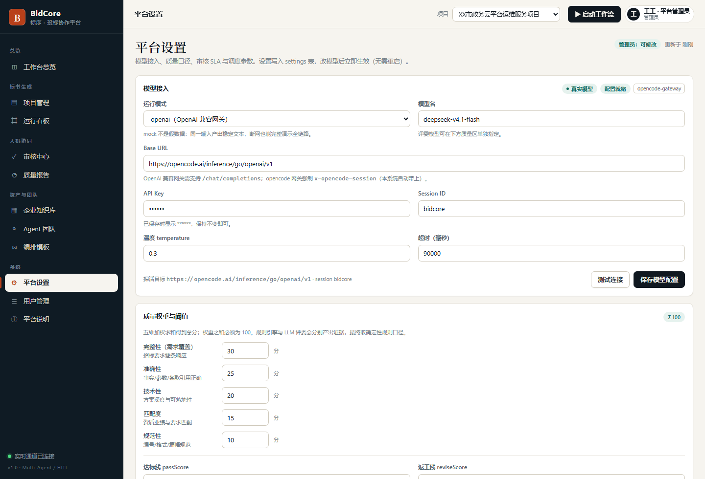 |

> 截图由 `tools/demo.mjs` 造数后、`tools/shot.mjs`（Chrome/Edge headless + CDP）抓取。
> 若页面出现红色“页面加载失败”，先确认 token 未过期、项目归属正确（`admin` 最稳）。

---

## 3. 问题与方案：yibiao 的三个缺口 → 本项目的三层能力

读完 `docs/PARITY-yibiao.md` 可以确认：yibiao 是一套成熟的“技术方案写作工具”，
但它的**流程控制**与**人机协同**是零散的。BidCore 针对三个真实缺口各补一层。

### 缺口 1：没有通用 workflow / HITL 引擎

yibiao 只有“任务 + 事件 + 域内确认”三件套：9 个 `tasks/start-*` 各自为战，
目录策略确认、偏离表确认、Agent 提问分别实现，彼此不共享状态机。
**方案：确定性工作流引擎（第 1 层）**

- Supervisor 规划 → 7 条计划校验 → FallbackPlan 兜底，永不因模型输出中断；
- 节点状态机 + 租约 + 版本化产物 + 失效传播 + 崩溃恢复（`run.recovered`）；
- `human-review` 是**一等节点类型**，命中即挂起 `waiting_human`、生成审核任务、推送 SSE。

### 缺口 2：技术方案是“一次性生成”，没有质量闭环

yibiao 的 6 步流水线是前端状态机，`technical-plan/state` 全量 RPC；质量只有导出前 lint，
**分数不驱动返工**。**方案：Self-Loop 质量闭环（第 2 层）**

- 14 条确定性规则 + 5 维度加权 + 受限评委（rubric 封顶）；
- 分数不达标 → 按“缺陷码 → 目标 Agent”表自动返工 → 目标重跑 → 自身失效 → 二次评估；
- 3 轮不达标或命中废标 → 熔断转人工，绝不无限烧 token；
- 人工可“接受当前质量”（只签字、不改分，可审计）。

### 缺口 3：人机协同碎片化，没有审核中心

yibiao 的确认动作散落在页面里，无统一待办、无 SLA、无多级、无评论、无幂等。
**方案：HITL 审核中心（第 3 层）**

- 统一审核包（产物 + 质量 + 证据 + 版本 diff + 上游意见 + 级别进度 + SLA）；
- 四动作：通过 / 驳回 / 修改 / 要求重新分析，驳回与修改**只能选祖先目标**；
- `commandId` 幂等 + `version` 乐观锁（409 “已被他人处理”）；
- 三级策略、SLA 提醒/升级、评论线程、admin 转派、审核历史。

> 一句话：yibiao 解决“写得出来”，BidCore 解决“**跑得稳、写得对、人能管**”。

---

## 4. 能力地图（对标 yibiao 页面 + 新增能力）

| yibiao 页面 / 能力 | BidCore 对应 | 状态 | 本项目新增 |
|---|---|---|---|
| Dashboard 项目总览 | `#/dashboard`：项目/运行/待审/质量均分/趋势/雷达 | ✅ | 待办审核、SSE 实时刷新、链路健康 |
| Projects 项目 CRUD | `#/projects`：列表/新建/搜索/启动运行 | ✅ | 工作台快照 `/workspace`、待审徽标 |
| Technical Plan 6 步 | `#/project/:id?tab=plan`：解析→目录→事实→正文→检查→导出 | ✅ | 响应偏离、查重、废标检查独立 tab |
| Task Engine 9 个 start-* | `/api/tasks/start-*` 兼容层 + 新七步流水线 | ✅ 兼容 | 统一 `tasks` 表、步骤幂等去重 |
| Rejection Check | `#/project/:id?tab=rejection` + `/checks/rejection/run` | ✅ | 废标项未响应 → 质量 veto → 强制人工 |
| Duplicate Check | `#/project/:id?tab=duplicate` + `/checks/duplicate/run` | ✅ | 相似度进入质量规则 TEC-03 |
| Response Deviation | `#/project/:id?tab=deviation`：生成/行内编辑/确认 | ✅ | 确认是**导出硬门禁**、编辑自动撤销确认 |
| Knowledge 四库 | `#/knowledge`：方案模板/工具资产/公司资质/人员资质 | ✅ | 证书到期聚合、`outline-references` 兼容 |
| Templates 模板 | 合并进知识库 `library=doc` | ⚠️ 简化 | 文件上传未实现（仅文本/元数据） |
| Prompts 管理 | 未实现 | ❌ 后续 | Agent 的 system_prompt 可在 Agent 页查看 |
| Users / 权限 | `#/users`（admin）+ `modules[]` | ✅ | 项目归属校验、审核可见性 |
| AI 代理配置 | `#/settings`：模型/质量/SLA/并行度 | ✅ | `x-opencode-session`、DB 覆盖 .env、即时生效 |
| —— | `#/runs`、`#/runs/:id`：运行看板 + DAG + 事件流 | ✅ 新增 | 节点抽屉、Supervisor 决策流、预算条 |
| —— | `#/reviews`、`#/reviews/:id`：审核中心 + 审核详情 | ✅ 新增 | 多级、SLA、评论、转派、四动作、版本 diff |
| —— | `#/quality`：维度雷达/14 规则/评委/迭代趋势/override | ✅ 新增 | 质量驱动返工（Self-Loop） |
| —— | `#/workflow`：默认 DAG、7 条校验、并行/SLA 策略 | ✅ 新增 | 计划版本与决策可视化 |
| —— | `#/agents`：9 角色（职责/模型档/tools/提示词/启停） | ✅ 新增 | 执行型 8 个 + Supervisor |

图例：✅ 已实现并验收；⚠️ 简化实现；❌ 未实现（后续）。

---

## 5. 架构

```
┌──────────────────────────── 浏览器（零构建 SPA） ────────────────────────────┐
│ index.html → app.js（hash 路由 / 项目上下文 / SSE / 徽标）                    │
│   views/*.js        dashboard projects project runs run reviews review …     │
│   lib/api.js        fetch 封装 + token + X-Project-Id + SSE 自动重连          │
│   lib/ui.js         h()/markdown()/dag()/radar()/diffView()/toast/drawer      │
└───────────────────────────────┬──────────────────────────────────────────────┘
                                │ REST + SSE(/api/events?projectId=&token=)
┌───────────────────────────────▼──────────────────────────────────────────────┐
│ server/index.mjs  node:http：路由匹配 / 静态资源 / SPA 回退 / 后台循环          │
│   api.mjs        按域组装 router（顺序=匹配优先级）                            │
│   routes/*.mjs   auth projects technical-plan checks export runs reviews      │
│                  quality knowledge agents settings users dashboard compat     │
├──────────────────────────────────────────────────────────────────────────────┤
│ domain/                                                                       │
│   engine.mjs     DAG 调度 / 租约 / 产物版本 / 失效传播 / 恢复 / Supervisor 视图 │
│   planner.mjs    计划校验(7) / FallbackPlan / 返工规则 / 并行分层              │
│   review.mjs     开 gate / ReviewPacket / 四动作 / 多级 / SLA / 评论 / 转派     │
│   quality.mjs    14 规则 / 5 维度 / 双轨封顶 / 配置校验 / override             │
│   tasks.mjs      技术方案七步流水线（唯一写入口 mutateState）                   │
│   bid.mjs        解析 / 目录 / 事实 / 正文 / 偏离 / 废标 / 查重 / 导出校验      │
│   docx.mjs       零依赖 OOXML 写 Word                                          │
│   llm.mjs        mock / OpenAI 兼容网关（x-opencode-session）                  │
│   diff.mjs       行级 diff（审核版本对比 / 运行产物对比）                       │
│   agents.mjs     8 个执行型 Agent 处理器                                       │
├──────────────────────────────────────────────────────────────────────────────┤
│ lib/  http.mjs(router/JSON) env.mjs(.env) util.mjs(scrypt/token) bus.mjs(SSE)  │
│       loops.mjs(SLA 30s / tick 1.5s / 租约回收 5s)                             │
├──────────────────────────────────────────────────────────────────────────────┤
│ db.mjs  node:sqlite：19 张表 + 幂等 ensureColumn 迁移 + 同步事务 tx()          │
└──────────────────────────────────────────────────────────────────────────────┘
```

**确定性外壳**是设计核心：LLM 只出现在「计划器」和「章节文字」两处；
调度、重试、失效、评分、审核流转全部是代码，因此演示可复现、可断点恢复。

---

## 6. 数据模型（19 张表）

| 表 | 主键 | 作用 | 关键字段 |
|---|---|---|---|
| `users` | id | 账号/角色/模块 | `username` `role` `modules` `title` `department` `status` |
| `projects` | id | 投标项目 | `code` `name` `bidder_name` `tender_text` `deadline` `budget` `owner_id` `tender_meta_json` |
| `knowledge_docs` | id | 知识库四库 | `library(doc/tool/company/personnel)` `folder` `category` `expires_at` `tags` |
| `agents` | id | 9 个角色 | `model_tier` `tools` `system_prompt` `enabled` |
| `workflow_defs` | id | 编排模板 | `key` `version` `graph_json` `policy_json` |
| `runs` | id | 一次运行 | `status` `plan_json` `plan_version` `context_json` `budget_json` `parallelism` `mode` |
| `node_runs` | id | 节点实例 | `node_key` `agent_key` `node_type` `status` `attempt` `iteration` `depends_on` `lease_*` `artifact_kind/version` `quality_score` |
| `artifacts` | id | 版本化产物 | `kind` `version` `status(active/frozen/superseded)` `sha256` `payload_json` `provenance_json` |
| `events` | id | 运行事件流水 | `seq` `type` `actor_type/id` `payload_json`（≤4KB 裁剪） |
| `commands` | id | 命令幂等表 | `(run_id, command_id)` 唯一，`type` `result_json` |
| `review_policies` | id | 审核策略 | `key` `levels_json` `timeout_json` |
| `review_tasks` | id | 人工门禁任务 | `gate_key` `level/level_total` `status` `assignee_*` `artifact_kind/version` `remind_at` `sla_due_at` `version` `policy_key` `escalated_from` |
| `review_decisions` | id | 不可变裁决 | `action` `comment` `targets_json` `edits_json` `reviewer_id` |
| `review_comments` | id | 评论线程 | `kind(comment/system)` `author_id` `body` |
| `quality_reports` | id | 质量报告 | `node_key` `iteration` `total_score` `dimension_json` `verdict` `findings_json` `judge_json` |
| `settings` | key | 平台配置 | `llm` `quality` `workflow` `review`（JSON） |
| `tasks` | id | 兼容层任务 | `type` `status` `progress` `logs_json` `stats_json` |
| `project_state` | project_id | 技术方案整棵状态 | `data_json`（bid_analysis/outline/global_facts/content/checks/deviation/export） |
| `exports` | id | 导出档案 | `file_name` `path` `bytes` `sha256` `validation_json` |

状态枚举（主要）：
`run.status` = planning / running / replanning / paused / waiting_human / completed / failed / cancelled；
`node.status` = pending / ready / running / waiting_human / succeeded / invalidated / skipped / failed；
`review.status` = pending / in_review / approved / rejected / modified / reanalyzed / escalated / cancelled。

---

## 7. API 一览

### 7.1 认证 / 基础

`POST /api/auth/login` · `GET /api/me` · `GET /api/health` · `GET /api/dashboard` · `GET /api/dashboard/health`

### 7.2 项目 / 技术方案

- 项目：`GET|POST /api/projects`、`GET|PUT /api/projects/:id`、`GET /:id/tender`、`GET /:id/workspace`
- 状态：`GET /api/projects/:id/technical-plan`；步骤 `POST …/technical-plan/steps {step,options}`
  （parse/outline/facts/content/checks/deviation/export/all）；保存 `POST …/outline`、`POST …/content {nodeId,markdown}`；
  条目 `GET …/requirements[?veto=1]`
- 偏离：`GET …/deviation`、`POST …/deviation/generate`、`PATCH …/deviation/rows/:rowId`、
  `POST …/deviation/confirm`（导出硬门禁）
- 检查/导出：`GET …/checks`、`POST …/checks/:kind/run`（rejection\|duplicate）、
  `POST /api/projects/:id/export`（阻断 409 `EXPORT_BLOCKED`）、`GET …/exports`

### 7.3 运行 / 工作流 / 兼容层

- 运行：`POST /api/runs`、`GET /api/runs[?projectId=]`、`GET /api/runs/:id`（快照）
- 命令：`POST /api/runs/:id/commands`（pause/resume/cancel/reconcile/retry-node，`commandId` 幂等）、
  `POST /api/runs/:id/nodes/:nodeKey/skip`
- 观测：`GET …/supervisor`、`GET …/events?afterSeq=`、`GET …/artifacts[/:kind]`、`GET …/diff?kind=&from=&to=`、`GET …/quality`
- 兼容层：`GET /api/technical-plan?projectId=` · `GET /api/tasks/active` · `POST /api/tasks/start-*` · `POST /api/tasks/pause-content-generation` · `POST /api/export/docx` · `GET /api/events` · `GET /files/:name`

### 7.4 审核（HITL）

`GET /api/reviews?status=&assignee=me&projectId=&overdue=1` · `GET /api/reviews/summary` ·
`GET /api/reviews/:id`（ReviewPacket）· `POST /api/reviews/:id/decisions`（四动作，`commandId` 必填）·
`GET|POST /api/reviews/:id/comments` · `POST /api/reviews/:id/reassign` · `POST /api/reviews/:id/remind` ·
`GET /api/reviews/:id/history`

### 7.5 质量 / 资产 / 系统

`GET|PUT /api/quality/config`（Σ=100 强校验，PUT 仅 admin）· `GET /api/quality/reports[?runId=&nodeKey=]` ·
`POST /api/runs/:id/quality/:reportId/override` · `GET|POST|PUT|DELETE /api/knowledge[...]` ·
`GET /api/knowledge/summary` · `GET /api/knowledge/outline-references` · `GET|PUT /api/agents[/:id]` ·
`GET|POST /api/workflow-defs` · `GET|PUT /api/settings` · `GET /api/llm/status` · `GET|POST|PATCH /api/users[/:id]`

---

## 8. HITL 四动作行为矩阵

所有决策都要求 `commandId`（缺 → `400 REVIEW_COMMAND_ID_REQUIRED`），并在 `commands` 表做幂等。

| 动作 | 必填 | 目标节点 | 任务状态 | 节点/运行变化 | 产物 |
|---|---|---|---|---|---|
| **approve 通过** | `commandId` | 不接受 | `approved` | 有下一级 → 生成下一级 `pending`，gate 仍 `waiting_human`；最后一级 → gate `succeeded`，`promoteReady + tick` 续跑 | 当前版本 `frozen` |
| **reject 驳回** | `commandId` + `targets`(祖先) + `comment≥10` | 祖先 Agent（如 parse-tender/knowledge/tech） | `rejected` | 目标 `attempt+1`、`iteration+1` → ready/pending；下游 `invalidated`；run 回 `running` | 保留旧版本，目标重跑产出 v(N+1) |
| **modify 修改** | 同上 + `edits[]` | 祖先 Agent | `modified` | 同 reject；`edits` 落到产物的 `provenance.human_edits` | 目标重跑，版本链可对比 |
| **reanalyze 重新分析** | 同 reject | 祖先 Agent | `reanalyzed` | 同 reject，且目标 Agent 的 active 产物标 `superseded` | 旧版显式“被取代”，不删除 |

共同约束：

- **祖先校验**：`targets` 只接受 gate 的上游 Agent，否则 `409 REVIEW_TARGET_NOT_ANCESTOR`；
- **乐观锁**：`UPDATE ... WHERE status=? AND version=?`，并发第二个决策 → `409 REVIEW_ALREADY_DECIDED`；
- **幂等**：同 `commandId` 重放直接回放 `commands.result_json`，结果逐字节一致；
- **人工返工也是 Supervisor 决策**：写 `supervisor.rework`（trigger=human、目标、原因、superseded 数）；
- **越权**：非 admin/非处理人/非项目 owner → `403 REVIEW_FORBIDDEN`。

---

## 9. 多级审核 / SLA / 评论 / 版本对比 / 断点恢复

### 9.1 多级审核

种子内置三条策略：

| policy | 级别 | 指派 | SLA | 超时 |
|---|---|---|---|---|
| `single` | 1 | 项目 owner | 120 min | remind-only |
| `default` | 1 → 2 → 3 | owner → `user:biz` → admin | 240 / 240 / 480 min | escalate / escalate / remind-only |
| `parallel` | 1（技术 + 商务并签） | `user:tech` + `user:biz` | 180 min | remind-only |

`review-1` 用 `single`（1 级），`review-2` 用 `default`（3 级）。
第 1 级通过 → 自动创建第 2 级任务（`next_review`），gate 节点保持 `waiting_human`；
最后一级通过才放行。`level_track` 同时返回已实例化级别与 `queued` 级别，前端画进度条。

> **并行并签（parallel policy）尚未在决策路径实现**：`openGate` 只取 `levels[0]`，
> approve 按 `level+1` 串行推进。策略数据与 UI 已就位，真正的“同级多任务并签”列为后续。

### 9.2 SLA 与升级

- `openGate` 按 policy 写入 `sla_due_at` 与 `remind_at`（SLA 的 75%）；
- 后台每 30s `scanSla()`：到 `remind_at` → `review.reminded`（SSE 徽标/Toast）；手工催办把 `remind_at` 推后 30min；
- 到期按 `on_timeout`：
  - `escalate`：旧任务 `escalated`，创建下一级任务（`escalated_from` + 双方系统评论 + `review.escalated` 事件）；
  - `auto-pass`：**仅当** `settings.review.allow_auto_pass === true` 才自动通过；默认关闭，关闭时退化为重复提醒；
  - `remind-only`：重复提醒。
- 已知限制：没有“改 SLA 时间”的公开接口，smoke 无法把 `sla_due_at` 提前来验证升级，因此该用例**跳过并说明**（实现存在，可改库或等真实到期验证）。

### 9.3 评论线程

- `review_comments` 与不可变的 `review_decisions` 分表：**裁决**与**沟通**分开；
- 长度 1–4000，空 → `REVIEW_COMMENT_TOO_SHORT`；
- 转派/升级/自动通过由服务端写 `kind=system` 评论；
- `comment_count` 以实际行数回算，不会漂移；SSE `review.commented`。

### 9.4 版本对比

- 产物唯一键 `(run_id, kind, version)`，每次重跑 `version+1`；
- `GET /api/runs/:id/diff?kind=tech.content&from=1&to=2` 返回行级 diff（`diff.mjs`）；
- 审核包自动带 `diff`：当前产物 vs 上一版（Markdown 走行 diff，JSON 走结构化 diff）；
- `reanalyze` 把旧版标 `superseded`，审核详情仍可切换 v1/v2 对比。

### 9.5 断点恢复

- 节点执行持 45s 租约（`lease_owner/lease_expires_at`）；
- 后台每 5s `reclaimExpired()` 把过期 `running` 节点收回 `ready`，写 `run.recovered`；
- 启动 3s 后 `reconcileAll()`：单进程部署下把所有 `running/planning` 运行强制对账；
- 手工：`POST /api/runs/:id/commands {type:'reconcile'}`（返回 interrupted/recovered/waiting）；
- `human-review` 任务不受进程重启影响：任务在 SQLite，重登后仍在审核中心。

---

## 10. Supervisor 调度规则与返工表

### 10.1 计划校验（7 条，失败即 FallbackPlan）

1. 计划是对象，`nodes` 长度 3–24；
2. `node_key` 合法（`^[a-z0-9-]{1,48}$`）且唯一；
3. `agent_key` ∈ 9 个注册角色；`node_type` ∈ agent/quality/human-review/export；
4. `human-review` 必须带 `review_policy_key`；`doc` 只能是 `export`；
5. 依赖必须存在、`depends_on` 为数组；
6. 拓扑排序无环；
7. 至少一个 sink 是 `export`。

真实模型失败 / 输出非法 → `plan.fallback` 事件 + 11 节点确定性 DAG（解析→检索→策略→质量→人工→技术/商务→合规→质量→三级人工→导出）。

### 10.2 调度与并行

- `parallelism` 默认 2（设置页可改）；`slots = parallelism - running`；
- 同批并行边界（`canParallel`）：
  - `tech` / `compliance` / `doc` 串行（避免同文件/同服务竞争）；
  - `human-review` 与 `export` 不并行；
  - 同一 Agent 的两个节点不并行；
- 真实并行批次写 `nodes.parallel` 事件（运行详情 Supervisor 面板可见）。

### 10.3 预算闸门

- 默认 `max_tokens=3,000,000`、`max_agent_calls=40`、`max_wall_ms=4h`；
- 超过 100% → 运行 `paused` + `budget.exceeded`；
- 超过 85% → `supervisor.budget_warning`（每 run 一次），并**跳过第二次评委**（省 token 先保结果）。

### 10.4 返工表（缺陷码 → 目标 Agent，确定性）

| 规则 | 维度 | 触发条件 | 返工目标 |
|---|---|---|---|
| REQ-01/02/03 | 完整性 | 解析项未完成 / 章节未覆盖 / 量化指标缺失 | tech |
| ACC-01/02/03 | 准确性 | 事实不一致 / 占位符 / 引用不可追溯 | tech |
| TEC-01/02/03 | 技术性 | 章节缺篇幅 / rubric 低 / 重复度高 | tech |
| MAT-01/02 | 匹配度 | 资质未命中 / 证书临期 | knowledge + commercial（并带 tech） |
| DOC-01/02/03 | 规范性 | 编号断号 / 导出必填缺失 / 篇幅不足 | doc（DOC-03 走 tech） |
| VETO | 完整性 | 废标条款未响应 | compliance → 强制人工 |

重规划（`plan.revised`）只加 `knowledge` 节点、不重排已成功节点，`plan_version + 1`。

---

## 11. Self-Loop：权重 / 阈值 / 双轨封顶

### 11.1 五维权重（合计 100）

| 维度 | 默认权重 | 说明 |
|---|---|---|
| requirement_coverage 完整性 | 30 | 解析项完成、章节响应覆盖、量化指标 |
| accuracy 准确性 | 25 | 事实一致、占位符、引用可追溯 |
| technical_quality 技术性 | 20 | 结构、rubric、重复度 |
| material_match 匹配度 | 15 | 资质命中、证书有效期 |
| documentation 规范性 | 10 | 编号、导出必填、篇幅 |

### 11.2 14 条规则（维度内按规则权重加权）

`REQ-01/02/03` · `ACC-01/02/03` · `TEC-01/02/03` · `MAT-01/02` · `DOC-01/02/03`，
外加 `VETO`（废标未响应，severity=veto）。每条 finding 带 `score/severity/message/evidence`，
证据可定位到条款/章节/指标/证书；前端“规则证据”可展开。

### 11.3 阈值与判定

| 配置 | 默认 | 作用 |
|---|---|---|
| `thresholds.pass` | 80 | ≥ 通过（进入人工审核） |
| `thresholds.revise` | 60 | 60–79 自动返工；<60 regenerate |
| `thresholds.duplicateSimilarity` | 0.72 | 查重阈值（TEC-03） |
| `thresholds.minSectionWords` | 120 | 单章篇幅下限（TEC-01/DOC-03） |
| `thresholds.certWarnDays` | 45 | 证书临期提醒（MAT-02） |
| `max_iterations` | 3 | 自动返工上限，超过熔断转人工 |
| `veto.cap` | 59 | 有 veto 时总分封顶 59 |
| `judge.cap_share` | 0.155（最大 0.35） | 评委最多影响总分 15.5 分 |

判定：`veto`（有 veto）/ `pass` / `revise` / `regenerate`。
另有“阻塞级封顶”：存在 blocking 缺陷（占位符、缺章）时总分最高 `pass-1 = 79`，
**进不了人工审核**，必须先返工——这是质量闭环的硬闸门。

### 11.4 评委（受限）

- 评委只输出 4 个 rubric（结构/可行性/针对性/可落地，0–5），映射到 `TEC-02`；
- `judge.two_pass=true` 时用更严标尺盲评第二次，**取两次更严**；预算 >85% 自动只跑一次并标注原因；
- 评委对总分影响被 `cap_share` 封顶（默认 15.5%），不允许模型单方面决定通过；
- **当前评委是确定性 rubric，不实际调用 LLM**；`judge.model` 仅作配置位（后续接入）。

### 11.5 配置校验

`PUT /api/quality/config` 严格校验：必须给全 5 个维度权重、Σ=100、`pass>revise`、
`0 ≤ cap_share ≤ 0.35`、`veto.cap ∈ [0,100]`、`1 ≤ max_iterations ≤ 10`；
任一不满足 → `400 QUALITY_CONFIG_INVALID`，**原配置不被写坏**（smoke 覆盖）。
`PUT /api/settings` 走宽松校验（兼容老表单），同样拒绝 Σ≠100。

---

## 12. 真实模型接入

### 12.1 `.env`

```ini
LLM_BASE_URL=https://opencode.ai/inference/go/openai/v1
LLM_API_KEY=oc_sk_xxx
LLM_MODEL=deepseek-v4.1-flash
LLM_SESSION_ID=bidcore
LLM_MODE=openai
LLM_TEMPERATURE=0.3
LLM_MAX_TOKENS=3000
LLM_TIMEOUT_MS=90000
LLM_JUDGE_MODEL=          # 留空=与生成模型相同（当前评委未实际调用）
PORT=5192
HOST=127.0.0.1
BIDCORE_LOG=0
```

### 12.2 `x-opencode-session`（必须）

该网关的 `POST /chat/completions` **强制要求非空 `x-opencode-session` 头**，否则 400：

```json
{"type":"error","error":{"type":"MissingSessionID","message":"Request is missing x-opencode-session ..."}}
```

`llm.mjs` 会自动带上 `session_id`（默认 `bidcore`，值任意非空即可，仅用于路由/会话粘性）。
模型默认固定 `deepseek-v4.1-flash`；`LLM_MAX_TOKENS=3000` 是为了给带 `reasoning_content`
的 DS 模型留足预算（太小会出现 `finish_reason=length` 且 `content` 为空）。

### 12.3 配置优先级与降级

- 优先级：`settings.llm` 非空值 > 环境变量 > 默认值；设置页保存后**立即生效**，无需重启；
- 没有 api_key → 自动 `mock`；
- 真实调用失败 → 该章回退确定性文本并追加 `<!-- LLM_FALLBACK: ... -->`，工作流不中断；
- `GET /api/llm/status` 返回 `mode/model/provider/session_id/ready`（key 永远不下发，设置页显示 `******`）。

### 12.4 模型实际用在哪（已接通）

| 位置 | 触发方式 | 失败行为 | 实测 |
|---|---|---|---|
| Supervisor 首次规划 | 每次启动运行（`planner.planRun`，JSON 模式） | 校验失败 → `plan.fallback` + 11 节点兜底 DAG | 10 节点计划、中文 rationale，来源 `llm` |
| 技术方案「✦ AI 生成本节」 | 人工在 `#/projects/:id?tab=plan` 点击 | 回退确定性章节，toast 标注 | 2143 字 / 44.9s / `deepseek-v4.1-flash` |
| `POST /api/projects/:id/technical-plan/content/ai` | 上面的按钮，或直接调用 | 同上；`llm.used=false` 时说明模型未启用 | 返回 `{node_id,markdown,words,llm{used,mode,model,provider,ms}}` |
| `POST /api/llm/probe` | 设置页「测试连接」 | 返回 `{ok:false,reason}` | `{ok:true,model,ms:2348,sample:"OK"}` |

> 设计取舍：**不把 21 章默认交给模型串行生成**——一次全册要 3~8 分钟且不可控。
> 默认仍用确定性写手保证离线可跑；需要模型时按节点击，人工决定哪些章值得花 token。
> 质量评委仍是确定性 rubric（`cap_share` 封顶 15.5%），**不参与"给自己打分"的闭环**，
> 避免单模型自证；这是反自评约束，不是未接通。

> 演示建议：现场网络不稳时先在设置页把模式切 `mock`，或在 `tools/demo.mjs` 里自动切 mock 后恢复。

---

## 13. 目录结构

```
bidcore/
├── server/    index.mjs api.mjs smoke.mjs seed.mjs reset.mjs db.mjs
│   ├── routes/   auth projects technical-plan checks export runs reviews quality
│   │             knowledge agents settings users dashboard compat workflow-defs ai _ctx
│   ├── domain/   engine planner review quality tasks bid docx llm agents diff knowledge
│   └── lib/      http env util bus loops
├── web/       index.html app.js app.css
│   ├── lib/      api.js ui.js
│   └── views/    login dashboard projects project(7 tabs) runs run reviews review
│                 quality knowledge agents workflow settings users about
├── tools/     demo.mjs（幂等演示数据） shot.mjs（headless 截图） probe-llm.mjs
├── docs/      DEMO.md（8 分钟脚本） PARITY-yibiao.md（对标分析） shots/*.png（界面截图）
├── .github/   workflows/ci.yml（语法检查 + 端到端冒烟）
├── var/       bidcore.db / files/*.docx（运行时生成，已 gitignore）
└── package.json  README.md  CHANGELOG.md  CONTRIBUTING.md  SECURITY.md  LICENSE  .env.example
```

---

## 14. 5 分钟演示脚本（精简版，完整版见 `docs/DEMO.md`）

1. **0:00–0:30 启动与登录**：`node server/index.mjs` → `admin/admin123`。
   讲：零依赖、单文件 SQLite、断网可跑。
2. **0:30–1:30 工作台总览**：项目卡、待办审核、质量均分/趋势、能力雷达。
   讲：yibiao 的 Dashboard 对标；这里多了待审与质量趋势。
3. **1:30–2:40 项目工作台 → 技术方案**：六步进度全绿；左侧目录 29 节点/21 叶，
   右侧 Markdown 编辑器；切「响应偏离」看 35 行、已确认；「废标检查」6 条、未响应 0。
   讲：技术方案不是黑盒，每一步可单独重跑；导出前有硬门禁。
4. **2:40–3:30 运行详情**：DAG 自上而下，同层并行；Supervisor 面板显示返工决策
   （`ACC-02 占位符 → tech`）、并行批次、预算 13K tokens、计划 v2。
   讲：质量不合格会自动返工，返工也是可审计的 Supervisor 决策。
5. **3:30–4:20 审核中心 → 审核详情**：SLA 倒计时、级别进度、产物/质量/规则证据、
   版本切换 + diff、评论线程、四动作按钮。
   讲：驳回/修改只能选祖先，提交幂等、重复处理 409。
6. **4:20–5:00 质量报告 → 导出**：雷达、14 条规则证据、迭代趋势；导出 Word（约 180KB），
   下载校验 PK 头。
   讲：质量分驱动返工，人工可“接受现状”留审计签字；导出必须偏离表已确认。

---

## 15. 验收清单

### 15.1 冒烟（`BIDCORE_BASE=http://127.0.0.1:5197 node server/smoke.mjs`）

基线：**42 通过 / 0 失败 / 1 跳过（共 43）**。CI 每次推送到 `main` 与每个 PR 都会跑同一套。

覆盖：健康检查、5 账号登录、`/api/me`、项目列表/详情/workspace、技术方案
parse→outline→facts→content→checks→deviation→confirm→export（requirements 35≥12、
outline 29≥18、21 节 14,059 字、docx 194,272 bytes、`validation.ok=true`、查重 55.4%）、
工作流到 `waiting_human`、审核包字段、评论、转派、驳回非祖先 409、approve 幂等、
乐观锁 409、modify（edits + 目标重跑）、reanalyze（superseded）、skip-node、reconcile、
多级 L1→L2、多次 approve 到 completed、Supervisor、SLA 提醒、Self-Loop 返工、
质量配置 Σ≠100 → 400、质量报告、兼容层 4 条（technical-plan / tasks / export / events）、
权限 403×2、恢复 llm 配置。

- 首轮 41/43：`reconcile` 路由把 `engine.reconcile()` 返回值整体塞进 `interrupted`，
  使该字段是对象而非数组；修正后复跑 **42/43 全绿**（0 失败）。
- 跳过：SLA 到期升级（无公开接口提前 `sla_due_at`，不构造假数据；实现见 `scanSla`）。

### 15.2 演示数据（`node tools/demo.mjs`）

本次示例（每次运行会重新生成）：

| 项 | 值 |
|---|---|
| 项目 | `#1 XX市政务云平台运维服务项目`（ZWY-2026-0117） |
| 技术方案 | step=exported，35 要求 / 29 节点 / 21 章 / 14,059 字 / 偏离 35 行已确认 / 导出 194,272 bytes |
| 待审运行（兜底计划） | `run_030ad5888c5f47ca800f9299`（gate=review-1） |
| 待审运行（LLM 计划） | `run_113fa6f497b248b7a555b4f5`（gate=review-strategy，10 节点动态编排） |
| 审核任务 | `rev_c310943e11a74ba3950f4148` |
| 已完成运行 | `run_68294235e5be415cb6b95d91`（11/11 节点，质量 91→79→93，含 1 次返工） |
| 导出文件 | `bidcore-p1-20261112154240.docx`（189.7 KB） |

### 15.3 截图（`docs/shots/`）

`login.png` 79K · `dashboard.png` 128K · `projects.png` 83K · `project.png` 132K ·
`run.png` 144K · `reviews.png` 109K · `review.png` 190K · `quality.png` 157K ·
`knowledge.png` 132K · `agents.png` 172K · `workflow.png` 95K · `settings.png` 111K。
补充：`run-waiting.png`（LLM 计划等待人工）、`project-{overview,tender,deviation,duplicate,rejection,export}.png`、`users.png`、`about.png`。

> 截图口径：`login` 未带 token；其余带 admin token + `projectId=1`。
> 工作台 `#/projects/1?tab=plan`、审核详情 `#/reviews/<id>` 均已验证可用。

---

## 16. 与原仓库的关系与差异

| 维度 | 原仓库 yibiao | 本项目 BidCore |
|---|---|---|
| 定位 | 技术方案写作工具（单文档 RPC） | 可人工干预的 Multi-Agent 投标平台 |
| 基线 | —— | `bidflow/`（11/11 smoke 已验证）重构 |
| 后端 | Fastify 5 + Prisma/PostgreSQL | `node:http` + `node:sqlite`，**零 npm 依赖** |
| 前端 | React 19 + Vite（构建） | 原生 ES Module + hash 路由（**零构建**） |
| 任务模型 | 9 个 `tasks/start-*` + 前端状态机 | 统一 workflow 引擎 + 七步技术方案流水线（兼容层保留 9 个入口） |
| 质量 | 导出前 lint | 14 规则 + 5 维 + 双轨封顶 + 自动返工（Self-Loop） |
| 人机协同 | ask-user / 目录确认 / 偏离确认，各自实现 | 统一审核中心：多级、SLA、评论、转派、四动作、幂等、乐观锁 |
| 产物 | 文档 + 状态 JSON | 版本化 artifacts（active/frozen/superseded）+ provenance + sha256 |
| 可观测 | SSE 5 频道 + 诊断页 | SSE 4 频道 + 事件流水 + Supervisor 决策视图 + 预算条 |
| 数据 | PostgreSQL 多表 | 19 张 SQLite 表，schema 与设计文档对齐，迁移只改类型 |

**没有复制 yibiao 的代码/视觉**：接口与信息架构对齐，页面与设计 tokens 重做；
兼容层保证旧客户端的最小可用路径（technical-plan / tasks / export / events）。

参考实现 [jdcome/OpenBidKit-Yibiao-Web](https://github.com/jdcome/OpenBidKit-Yibiao-Web) 采用 **AGPL-3.0**；
BidCore 是独立实现（零依赖 `node:http` + `node:sqlite` + 原生 ES Module，与其 Fastify + Prisma/PostgreSQL + React/Vite 无共用代码），
因此按 **MIT** 发布。对标过程的阅读笔记见 [`docs/PARITY-yibiao.md`](docs/PARITY-yibiao.md)。

---

## 17. 已知问题与修复记录

> 缺陷记录与复测结论；`web/**`、`server/routes/**`、`server/domain/**` 的改动都必须回到冒烟里复测。

**已修复（复测通过）**

1. 审核详情 `#/reviews/:id` 曾报 `state.comments is not iterable`（委派路径状态初始化错误）；
2. Dashboard 曾把 `/api/dashboard.projects`（对象）当数组，`projects.filter` 抛错并常驻降级提示；
3. 工作台曾只能用 `#/project/:id`，`#/projects/:id` 落到项目列表（路由契约不一致）；
4. `reconcile` 命令曾把 engine 返回值嵌套进 `interrupted`，导致响应不是数组；
5. 技术方案 tab 曾显示 52 节/13673 字（legacy `outlineData.sections` 与新 `outline.nodes` 混算）；
6. 审核产物摘要曾显示 `[object Object]`（对象未序列化）。

**仍然存在 / 未实现（后续）**

1. SLA 到期升级没有公开接口可提前 `sla_due_at`，smoke 以“跳过 + 说明”处理；逻辑已实现（`scanSla`），可改库或等真实到期验证。
2. 并签审核（`parallel` policy）只有策略与 UI，决策路径仍按 `level+1` 串行。
3. Prompt 管理、知识库文件上传/预签名 URL 未实现。
4. LLM 评委当前是确定性 rubric，`judge.model` 仅配置位；`cap_share` 已把影响封顶 15.5%。
5. 正文生成“暂停/续跑”仅在兼容层改任务状态，不是真正的断点续跑。

---

## 贡献

欢迎 PR 与 issue。请先读 [CONTRIBUTING.md](CONTRIBUTING.md)：本项目零 npm 依赖、无构建步骤，
改动必须让 `node server/smoke.mjs` 保持 **42 通过 / 0 失败 / 1 跳过** 或更好。
安全问题请走 [SECURITY.md](SECURITY.md) 的私密渠道，不要开公开 issue。
版本变更记录见 [CHANGELOG.md](CHANGELOG.md)。

## 许可证

[MIT](LICENSE) © 2026 YG

> 演示账号（`admin/admin123` 等）与内置令牌密钥（`bidcore-demo-secret-change-me`）仅供本机体验；
> 对外暴露前请改口令并设置 `BIDCORE_SECRET`，详见 [SECURITY.md](SECURITY.md)。

---

> 说明：`docs/shots/` 共 22 张截图（README 引用其中 12 张主图）。
> 常用命令：`node server/index.mjs` / `node server/reset.mjs` / `node server/smoke.mjs` / `node tools/demo.mjs` /
> `node tools/shot.mjs "<url>" out.png --token=<token> --project=1` / `node tools/probe-llm.mjs`。

